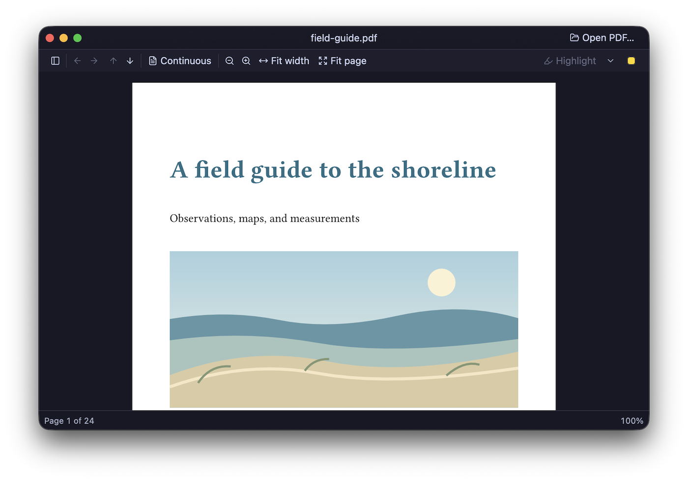
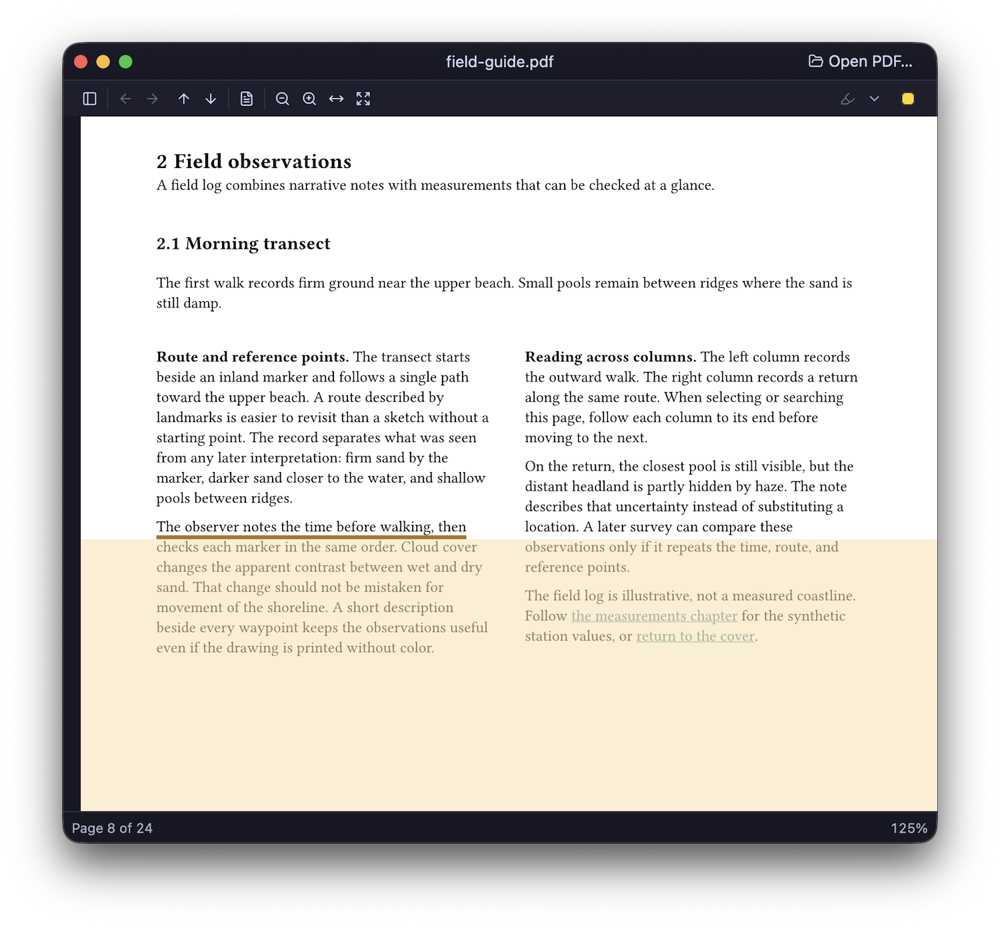
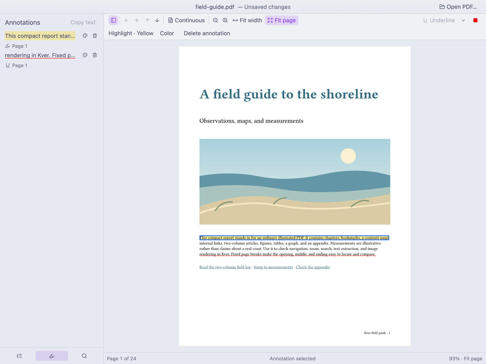
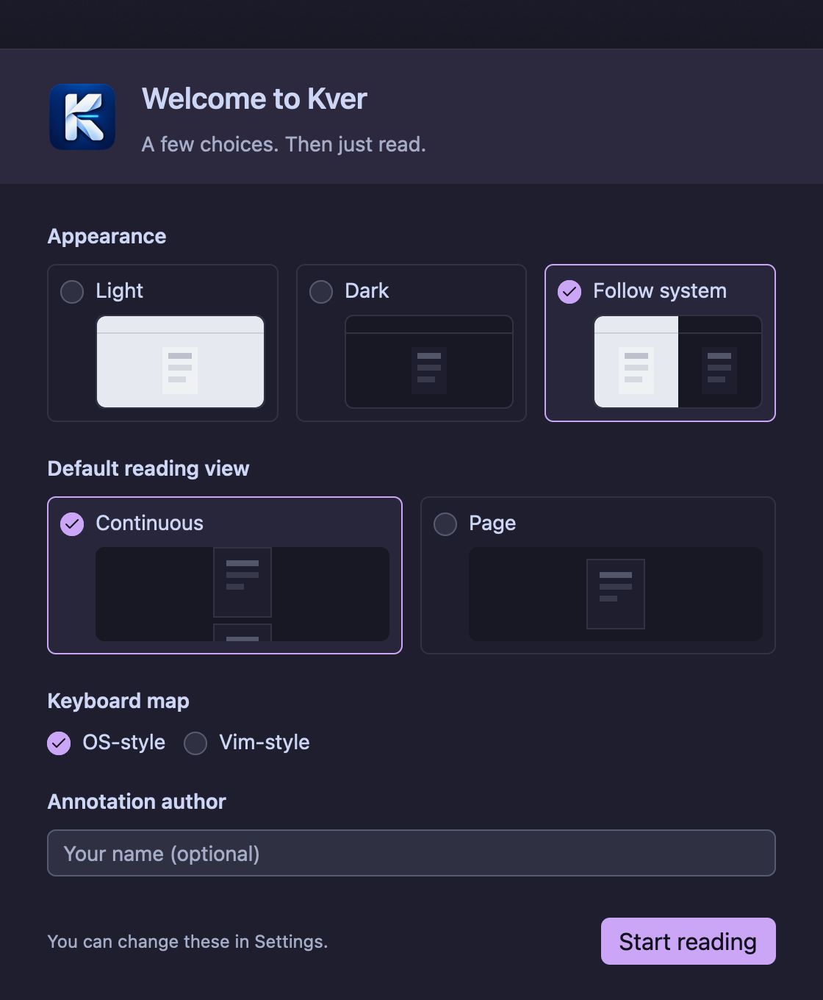

# Kver

**A keyboard-friendly PDF reader that keeps the document at the centre.**

Read, find, and navigate PDFs in a minimal desktop interface. Kver pairs
Vim-style keyboard navigation with ordinary mouse controls, inspired by
[Sioyek](https://sioyek.info/) and [Skim](https://skim-app.sourceforge.io/).
It is a general-purpose reader, whether you are working through a technical
paper, a book, or a manual.

_Kver_ is Icelandic for a small book or booklet.

**[Download for macOS](https://github.com/JonGretar/Kver/releases)** ·
[Keyboard customization](docs/keybindings.md) · [Changelog](CHANGELOG.md)

## Made for reading

It like... reads PDFs. Just in a way that I like. With limited mouse-y-feel-y. TOC right when you need it.  Oh... And vim style marks. Did I mention that?

No unneeded UI in your way and the little there is is mostly optional. Everything is behind a command palette thingy anyway.

### The Visual ruler

The visual ruler eases reading PDFs my marking your reading positions for easier following. Enable it and move it around with your movement keys. It tries it's best to follow the columns.

### Text markup

It does that. Easy peasy with little thrill. Though it can also give you a list of annotation which is nice I guess.

### It's not finished yet

A lot more is planned. check the [Roadmap](docs/roadmap.md) for some ideas of where I might take this..

## Install

### macOS (Apple silicon)

1. Download the macOS ZIP from [GitHub Releases](https://github.com/JonGretar/Kver/releases).
2. Extract it and drag `Kver.app` into **Applications**.
3. Open Kver and choose a PDF with **Open PDF**. You can also open PDFs from
   Finder using **Open With → Kver**.

Kver is not yet Apple Developer ID signed or notarized. macOS may block a
downloaded copy with a security warning. Only approve it if you obtained it
from the project's release page and trust the source.

After a blocked launch, open **System Settings → Privacy & Security → Open
Anyway** and confirm. Do not disable Gatekeeper globally.

### Windows and Linux

Windows and Linux are targets, but supported downloads are not available
yet. Packaging and native testing need contributors—if you would like to
help, [open an issue](https://github.com/JonGretar/Kver/issues).

## Get started

1. **Open a PDF.** Use **Open PDF**, Command-O, or Finder's Open With.
2. **Move through it.** With the default Standard preset, use ↑/↓ to scroll,
   ←/→ to turn pages, and the toolbar to zoom or fit the page. Single Page
   mode scrolls within a page; use page-turn commands to change pages.
3. **Find a passage.** Use Command-F to search or Command-T to open Contents
   when the PDF provides an outline. Select ordinary text and press Command-C
   to copy it.
4. **Discover commands.** Press Command-Shift-P to open the command palette. It shows
   available commands and their shortcut hints.
5. **Make it yours.** Open **Kver → Settings…** (Command-,) for appearance,
   reading defaults, history, and keyboard preferences.

These shortcuts use the Standard preset on macOS. Choose **Vim** in
**Settings → Keyboard** for Vim-style navigation; that page shows the active
shortcuts. See [Customize keyboard shortcuts](docs/keybindings.md) for
configuration examples.

### Remembering your reading

Use **Open Recent** to find previously opened PDFs. Settings lets you choose
whether to record reading history and reopen at the last position. Turn
recording off to keep new reading activity session-only, or forget a PDF
without deleting the file.

## Development

Want to build Kver or contribute? See the [development guide](docs/development.md)
for setup, running from source, builds, tests, and the source map.
For longer-term ideas, see [Future direction](docs/roadmap.md).

## License

Kver's original code, documentation, and app icon are [MIT-licensed](LICENSE).
Third-party dependencies and copied material retain their own licenses.
