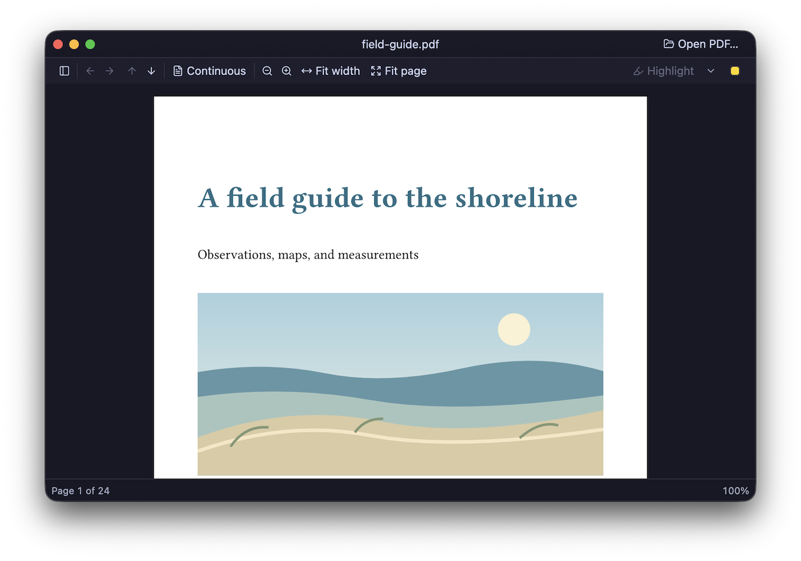
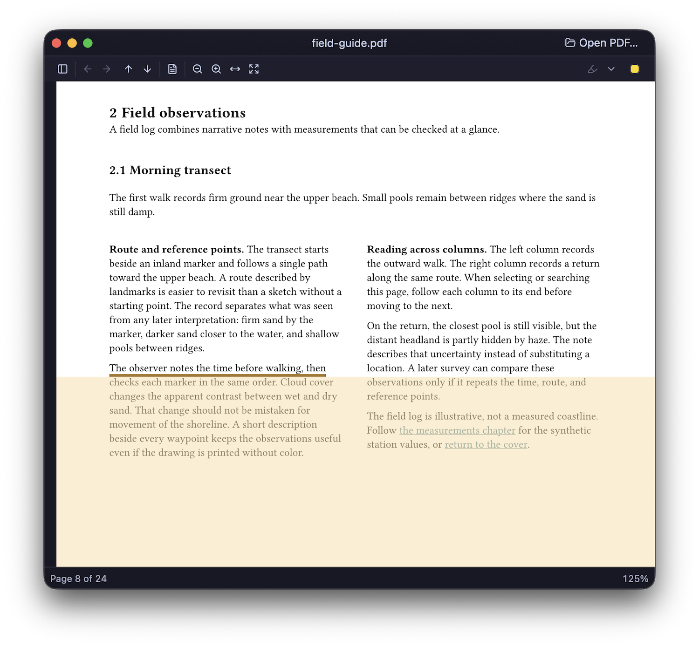
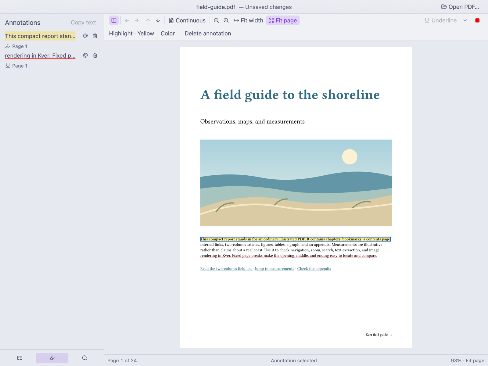
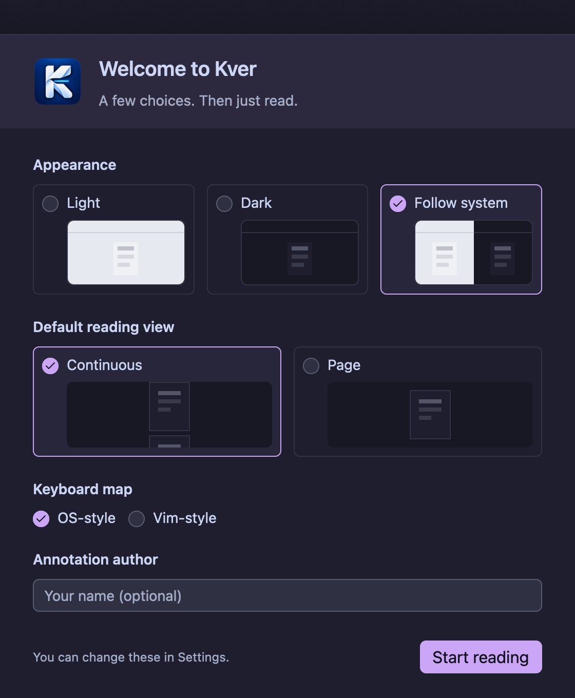

# Kver

**A keyboard-friendly PDF reader that keeps the document at the centre.**

Read, find, and navigate PDFs in a minimal desktop interface. Kver pairs
Vim-style keyboard navigation with ordinary mouse controls, inspired by
[Sioyek](https://sioyek.info/) and [Skim](https://skim-app.sourceforge.io/).
It is a general-purpose reader, whether you are working through a technical
paper, a book, or a manual.

_Kver_ is Icelandic for a small book or booklet.

**[Download for macOS](https://github.com/JonGretar/Kver/releases)** ·
[Keyboard customization](docs/keybindings.md) · [Changelog](CHANGELOG.md)

## Made for reading

It like... reads PDFs. Just in a way that I like. With limited mouse-y-feel-y. TOC right when you need it.  Oh... And vim style marks. Did I mention that?

No unneeded UI in your way and the little there is is mostly optional. Everything is behind a command palette thingy anyway.

### The Visual ruler

The visual ruler eases reading PDFs my marking your reading positions for easier following. Enable it and move it around with your movement keys. It tries it's best to follow the columns.

### Text markup

It does that. Easy peasy with little thrill. Though it can also give you a list of annotation which is nice I guess.

### It's not finished yet

A lot more is planned. check the [Roadmap](docs/roadmap.md) for some ideas of where I might take this..

## Install

### macOS (Apple silicon)

1. Download the macOS ZIP from [GitHub Releases](https://github.com/JonGretar/Kver/releases).
2. Extract it and drag `Kver.app` into **Applications**.
3. Open Kver and choose a PDF with **Open PDF**. You can also open PDFs from
   Finder using **Open With → Kver**.

Kver is not yet Apple Developer ID signed or notarized. macOS may block a
downloaded copy with a security warning. Only approve it if you obtained it
from the project's release page and trust the source.

After a blocked launch, open **System Settings → Privacy & Security → Open
Anyway** and confirm. Do not disable Gatekeeper globally.

### Windows and Linux

Windows and Linux are targets, but supported downloads are not available
yet. Testers can obtain experimental archives from
[GitHub Releases](https://github.com/JonGretar/Kver/releases), with manual updates:

- [Linux x86-64 tarball: download, requirements and optional launcher installation](docs/linux.md)
  — Ubuntu 24.04/glibc 2.39 baseline; no older-distribution promise.
- [Windows x86-64 ZIP: download, runtime and security guidance](docs/windows.md)
  — unsigned; requires the Microsoft x64 v14 runtime.

These downloads are experimental, not native GUI certification. Each guide
explains extraction, use, updates and useful bug reports. No GitHub sign-in is
required. Archives appear after the macOS release if their builds succeed.
Native testing needs contributors—see [the per-OS acceptance gaps](https://github.com/JonGretar/Kver/issues/183).

## Get started

1. **Open a PDF.** Use **Open PDF**, Command-O, or Finder's Open With.
2. **Move through it.** With the default Standard preset, use ↑/↓ to scroll,
   ←/→ to turn pages, and the toolbar to zoom or fit the page. Single Page
   mode scrolls within a page; use page-turn commands to change pages.
3. **Find a passage.** Use Command-F to search or Command-T to open Contents
   when the PDF provides an outline. Select ordinary text and press Command-C
   to copy it.
   For keyboard selection, choose **Visual select…** from the command palette
   (`v` in Vim), then type the first and last word's two-letter hints.
   Use **Visual select line…** (`V` in Vim) to include complete endpoint lines,
   even when their beginnings or ends are clipped.
4. **Discover commands.** Press Command-Shift-P to open the command palette. It shows
   available commands and their shortcut hints.
5. **Make it yours.** Open **Kver → Settings…** (Command-,) for appearance,
   reading defaults, history, and keyboard preferences.

These shortcuts use the Standard preset on macOS. Choose **Vim** in
**Settings → Keyboard** for Vim-style navigation; that page shows the active
shortcuts. See [Customize keyboard shortcuts](docs/keybindings.md) for
configuration examples.

On Linux and Windows, open the **Kver** menu in the title bar for file and
window commands, Settings, About, and Quit. Its shortcut hints follow your
current keyboard configuration.

### Opening from the terminal

Run `kver some.pdf` to open a PDF in the most recently active reader, even
when Kver is already running. Use `kver --new-window some.pdf` to open
another window instead.

For a PDF on the web, choose **Open URL…** or run `kver 'https://example.org/book.pdf'`.
Web PDFs stay in memory and out of Open Recent until you choose **Save** and pick a location.

See [Command-line usage](docs/cli.md) for macOS setup, window preferences,
and available options.

### Remembering your reading

Use **Open Recent** to find previously opened PDFs. Settings lets you choose
whether to record reading history and reopen at the last position. Turn
recording off to keep new reading activity session-only, or forget a PDF
without deleting the file.

### Keep two passages in view

Choose **Split side by side** or **Split top and bottom** from the command
palette to read two locations in the same PDF. The new pane starts at your
current location. Drag the divider to give either passage more room.

Click a pane or use **Switch pane** to make it active. Navigation, Find
results, selections, and the reading ruler follow that pane; scrolling or
pinching over the other pane changes that view without switching the keyboard
target. Both panes share annotations, undo, and saving.

**Close pane** removes the active view; **Keep only this pane** keeps it and
removes the other. Neither closes the PDF. Reopening restores one ordinary
reading position, not the split. See [split shortcuts](docs/keybindings.md#split-reading)
for keyboard commands.

## Development

Want to build Kver or contribute? See the [development guide](docs/development.md)
for setup, running from source, builds, tests, and the source map.
For longer-term ideas, see [Future direction](docs/roadmap.md).

## License

Kver's original code, documentation, and app icon are [MIT-licensed](LICENSE).
Third-party dependencies and copied material retain their own licenses.
